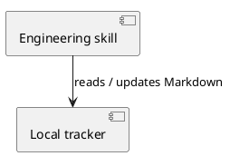

# UML rendering in this repo

## Local renderer

- Status: verified on 2026-10-29. A temporary component/dependency probe rendered
  successfully to SVG and PNG; the PNG preview was visually inspected for legible,
  unclipped labels and dependency direction. This verifies tooling, not a domain model.
- Machine-specific wrapper: `C:\Users\matts\.agents\bin\plantuml.cmd`.
- Machine-specific JAR: `C:\Users\matts\.agents\tools\plantuml\plantuml-1.2024.8.jar`.
- Machine-specific Java: `C:\Program Files\Eclipse Adoptium\jdk-25.0.5.8-hotspot\bin\java.exe`.
- Versions: PlantUML 1.2024.8; Temurin OpenJDK 25.0.5+8 LTS.
- Layout: bundled Smetana, selected in the source with `!pragma layout smetana`.
  No external Graphviz is needed for this probe. PlantUML's version check also
  detected Graphviz 2.44.1; that engine was not used for the probe.
- Fonts: Java logical `SansSerif` (`skinparam defaultFontName SansSerif`);
  physical font substitution depends on the machine.
- Dependencies: installed Java and the local JAR; no remote includes. Use UTF-8,
  headless Java and PlantUML's SANDBOX security profile.

## Reproduce in PowerShell

Replace the source path with a local `.puml` file. The explicit Java path avoids
depending on the wrapper's Java PATH lookup. Output appears beside the source.

```powershell
$rendererJava = 'C:\Program Files\Eclipse Adoptium\jdk-25.0.5.8-hotspot\bin\java.exe'
$rendererJar = 'C:\Users\matts\.agents\tools\plantuml\plantuml-1.2024.8.jar'
$diagramSource = 'C:\path\to\diagram.puml'
& $rendererJava '-Djava.awt.headless=true' '-DPLANTUML_SECURITY_PROFILE=SANDBOX' -jar $rendererJar -charset UTF-8 -failfast2 -tsvg $diagramSource
& $rendererJava '-Djava.awt.headless=true' '-DPLANTUML_SECURITY_PROFILE=SANDBOX' -jar $rendererJar -charset UTF-8 -failfast2 -tpng $diagramSource
```

Probe source (temporary tooling check):



Use the `uml` skill for authoritative rendering procedures and environment
authorization rules. Verify availability on every invocation and inspect the
current preview. Tool installation and external rendering need separate
authorization. Missing rendering defers only decisions requiring a visual preview.
